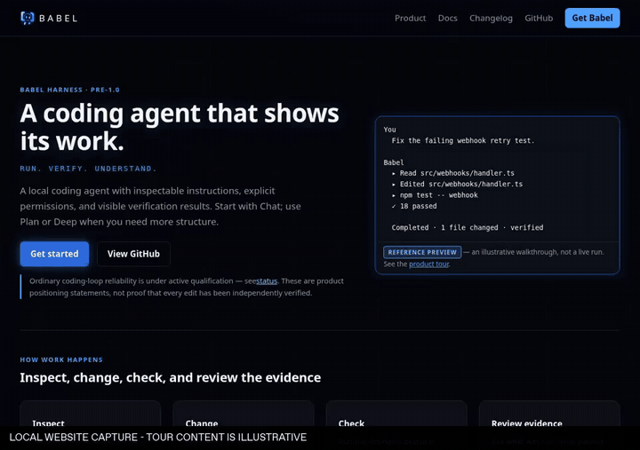
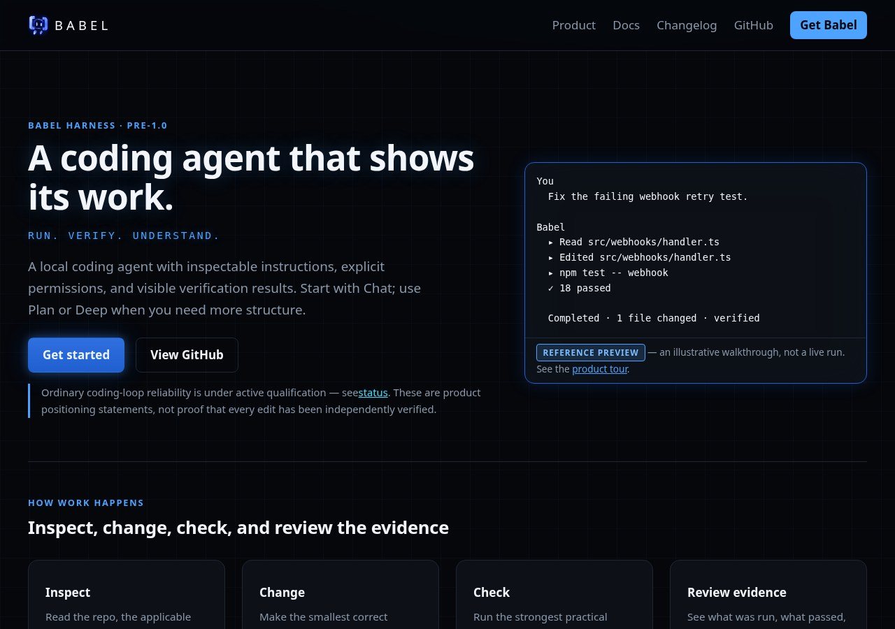
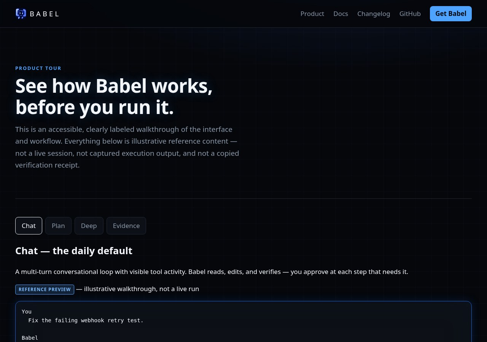
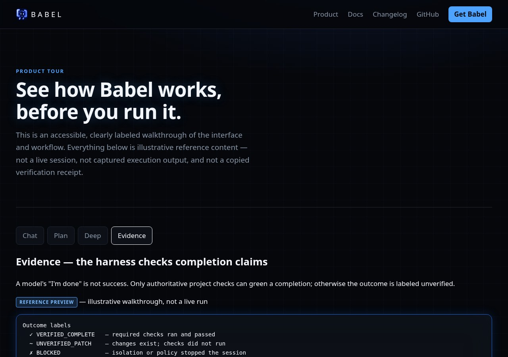
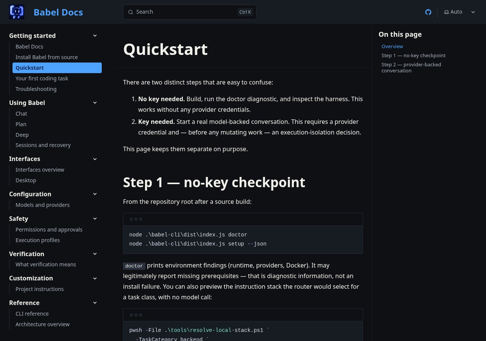

# Babel — Product Website & Docs

Astro + Starlight static site for Babel Harness: product homepage, task-oriented
documentation, and an honest status/download/changelog surface.

> **Status: proprietary.** This repository is public for source visibility and
> transparency. It is **not open source** — there is no license grant to reuse,
> modify, or redistribute this code. See [LICENSE](LICENSE).

## See it in action

Browse the product homepage, switch the reference tour to its Evidence panel, then open the source-linked quickstart guide.

<a href="docs/showcase/media/workflow.mp4"></a>

[Watch or download the MP4](docs/showcase/media/workflow.mp4) · [Capture notes and reproduction](docs/showcase/README.md)

**What you are seeing:** Actual browser footage of this static website. The tour and terminal transcripts are explicitly illustrative reference content; they are not captured Babel executions or verification receipts.

**Demo status:** [Visit the website](https://babel-origin-site.vercel.app/). The public URL returned HTTP 200 on 2026-10-30. Media below comes from the pinned local build, so the hosted deployment may differ.

<table>
<tr>
<td width="50%"><br><strong>1. Product homepage</strong><br>Babel product website home, rendered from committed static content.</td>
<td width="50%"><br><strong>2. Reference tour</strong><br>Product tour explicitly labeled as illustrative reference content.</td>
</tr>
<tr>
<td width="50%"><br><strong>3. Evidence reference panel</strong><br>Reference Evidence panel; these sample outcome labels are not a real run.</td>
<td width="50%"><br><strong>4. Quickstart documentation</strong><br>Task-oriented quickstart documentation, with source revision provenance.</td>
</tr>
</table>

Captured from [`dfaeb8b91802`](https://github.com/gthgomez/babel-origin-site/tree/dfaeb8b91802ff8d851272260439e9c166107d63) on 2026-10-30. The GIF is a compact preview; the MP4 preserves the recorded workflow timing.

## Architecture

- Marketing pages: `src/pages/` (Astro, static output to `dist/`)
- Documentation: `src/content/docs/` (Starlight, 18 source-linked guides)
- Product claims: `src/data/*.json` validated by `src/lib/product-content.ts`
- Security: build-generated meta CSP with script hashes — see
  [docs/security-decision.md](docs/security-decision.md)

Product source of truth: [gthgomez/Babel](https://github.com/gthgomez/Babel).

## Local use

```powershell
npm ci
npm run verify
```

- `npm run dev` — dev server
- `npm run build` — static production build → `dist/`
- `npm run test:e2e` — Playwright against the built artifact
- `npm run check:sources` — read-only upstream snapshot audit (never in build)

Vercel: framework Other, build `npm run build`, output `dist`, no environment
variables.

## Content rules

All product claims derive from the pinned snapshot in
`src/data/product-status.json`. See
[docs/content-maintenance.md](docs/content-maintenance.md) for the refresh
procedure and [docs/security-decision.md](docs/security-decision.md) for the CSP
design.

## License

Proprietary; see [LICENSE](LICENSE). Babel and third-party materials retain
their own licenses.
